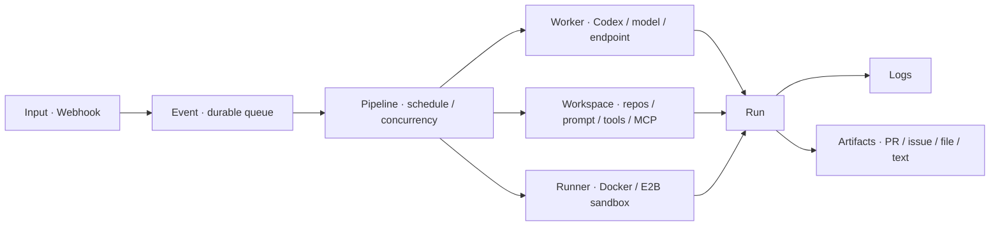

# 声明式资源与执行流程

## 资源关系



资源采用 `apiVersion: cloudpilot.dev/v1alpha1`、`kind`、`metadata` 和 `spec`。`metadata.name` 是 1–63 个小写字母、数字或连字符组成的名称，首尾不能为连字符；名称只在同一 kind 下唯一。网页表单和 YAML 导入共用同一套校验及默认值。

导入接受以 `---` 分隔的多个 YAML 文档，单次最多 100 个对象、YAML 文本最多 1 MiB。服务先校验整个批次及其引用，再在事务中 upsert；批次内资源无需按依赖顺序排列。未知字段和不存在的引用会使整个导入失败。导入不会删除没有出现在文件中的对象。

服务返回的 `metadata.generation` 随修改递增。编辑时携带读取到的 generation 可检测过期修改，冲突返回 HTTP 409；可复用的声明式模板省略 generation。删除被其他资源引用的对象会失败，仍有排队、运行、等待继续或待确认事件，以及未关闭会话的 Pipeline 也不能删除。

| Kind | 核心配置 |
| --- | --- |
| `Input` | `type: webhook`、`pipelineRef`、`secret`、`paused` |
| `Pipeline` | `workerRef`、`workspaceRef`、`runnerRef`、`schedule`、`timezone`、`concurrency`、`paused`、`maxRetries`、`timeoutSeconds` |
| `Worker` | `type: codex`、`model`、`endpoint`、`apiKeySecretRef`、`instructions` |
| `Workspace` | `repositories`、`prompt`、`tools`、`mcpServers`、`env`、`secretEnv` |
| `Runner` | `type: docker` 配置 `image`、`network`、`memory`、`cpus`；`type: e2b` 配置 `e2b` 服务商与模板选项 |

## 从反馈到执行

修改 [夜间反馈示例](../examples/nightly-feedback.yaml) 的仓库地址和可用模型，填写 Worker 的 `apiKey` 与 Input 的 `secret` 后，通过管理界面导入。将 Workspace 引用的 `GITHUB_TOKEN` 配置在 CloudPilot 服务环境中，用于仓库认证和 issue、PR 操作；若只分析公开仓库，可删除 Workspace 的 `secretEnv` 映射。不删除该映射时，缺少 GitHub token 会使运行失败。

远程 sandbox 可从 [Novita 示例](../examples/novita.yaml) 开始，模板构建和 Runner 配置见 [E2B / Novita runner](2026-11-01-e2b-runner.md)。

接入点的 `secret`、`github.token` 与 API key 均加密保存，读取和导出不回显；编辑留空保留已有值。旧 `secretRef`、`tokenSecretRef`、`apiKeySecretRef` 及 `secretEnv` 继续支持服务进程环境变量引用，导出保留引用名称。

应用后端调用：

```sh
curl -X POST http://localhost:8080/hooks/app-feedback \
  -H "Authorization: Bearer $FEEDBACK_WEBHOOK_SECRET" \
  -H 'Content-Type: application/json' \
  -H 'Idempotency-Key: feedback-1042' \
  --data '{"feedbackId":"1042","message":"登录后打开设置页会崩溃","appVersion":"1.8.0"}'
```

Webhook 接受最多 1 MiB 的任意有效 JSON，认证成功后持久化为 Event 并返回 HTTP 202。`Idempotency-Key` 最多 190 字节；同一 Input 重复使用相同 key 会返回原事件，即使原事件已完成也不会重复排队。应用后端应为同一次反馈的重试使用同一 key；浏览器客户端不应持有 Webhook secret。

示例 Pipeline 每天上海时间 20:00 释放当时已排队的事件，并最多同时运行两个任务。这个时间点之后的新事件等待下一次定时触发。`schedule` 为空时即时调度；否则使用五字段 cron，时区由独立的 IANA `timezone` 指定，默认 `Asia/Shanghai`。手动触发会释放当前待处理批次。`paused` 阻止新的调度，不中断已经运行的任务。

每个初始执行尝试生成独立 Run，关联原 Event。Codex 通过 Docker 或 E2B runner 在 Run 内保留交互式会话，人工补充或继续会创建新的轮次；已建立 thread 的执行在中断、超时或失败后保留现场，等待人工继续。首次执行在 thread 建立前失败且空会话清理成功时，以及批处理适配器失败时，按 `maxRetries` 重试，默认不自动重试。人工追加的轮次不自动重放。`timeoutSeconds` 默认 3600，允许 10–86400 秒；交互式执行按轮次计时。`concurrency` 默认为 1，允许 1–32，空闲会话不占并发额度。关闭会话后，可将失败、取消或中断的 Event 重新入队，创建新的 Run。

交互轮次执行成功时，Run 为 `succeeded`、Event 为 `awaiting_review`，等待操作者检查产物。确认完成并结束会话、清理成功后，Event 才为 `succeeded`；批处理适配器执行成功仍直接完成 Event。

运行详情提供对话与工具时间线、人工补充、中断、继续和结束任务，具体语义见 [Agent 会话与人工介入](2026-10-31-interactive-sessions.md)。日志和时间线使用各自的游标轮询；事件、运行与产物列表显示最新 200 条记录。

## Workspace 和 Codex

Runner 在独立容器或 sandbox 的 `/workspace` 下检出仓库。仓库条目包含 `url`、可选 `ref`、相对 `path`；路径不得越界或相互覆盖。`tools` 是按顺序执行的 shell setup 命令，可用于准备构建工具或项目依赖。交互式会话只在首次准备工作目录时检出仓库和执行 setup，后续轮次继承已有文件修改。预装大型依赖时，可基于 [deploy/worker](../deploy/worker) 构建 Docker 镜像，或使用 [deploy/sandbox](../deploy/sandbox) 的 SDK 脚本构建 Novita 模板。

`env` 配置非敏感环境变量；`secretEnv` 将执行环境内变量名映射为服务环境中的密钥变量名，例如 `GH_TOKEN: GITHUB_TOKEN`。网页中两者均以可增删的键值行编辑，会校验变量名并拒绝重复；YAML 中仍使用映射对象。`mcpServers` 每项配置 `command` 或 HTTP(S) `url` 其中之一；stdio 服务还可设置 `args`、`env`。通过 `secretEnv` 向 MCP 子进程传递所需凭据，避免将密钥明文写入资源。

仓库提供的执行镜像和 sandbox 模板均包含 Git、GitHub CLI 和 Codex。提供 `GH_TOKEN` 或 `GITHUB_TOKEN` 时，GitHub HTTPS 克隆通过限定于 `github.com` 的凭据 helper 认证；私有仓库、issue 和 PR 操作需要该 token 对目标仓库具有对应权限。

Worker 提供模型、API endpoint、API key 及通用指令。`Worker.spec.apiKey` 和 `Runner.spec.e2b.apiKey` 可在界面或导入 YAML 中直接填写，服务使用启动主密钥加密后存入数据库。API 和 YAML 导出均省略密钥及其密文；编辑时省略或留空会保留已有值，填写新值会替换。向新数据库导入导出文件时，需要重新提供 API key。旧 `apiKeySecretRef` 仍支持环境变量引用；显式填写该引用且不提供新 `apiKey` 时，会切换回环境变量凭据。

Workspace 提供项目提示词。每次 Run 会把配置和反馈事件交给 Codex；模型 API key 仅通过执行环境传入，沙箱管理 key 留在控制平面。是否创建 issue、PR 或构建 APK 由任务、仓库工具链和可用权限共同决定。CloudPilot 负责执行和收集，不能保证 Agent 每次都产生所有类型的产物。

## 产物协议

Agent 将文件放到 `/output`，并写入 `/output/artifacts.json`：

```json
{
  "artifacts": [
    {"kind":"pr","name":"Fix settings crash","url":"https://github.com/your-org/your-app/pull/42"},
    {"kind":"issue","name":"Feedback 1042","url":"https://github.com/your-org/your-app/issues/41"},
    {"kind":"file","name":"app-debug.apk","path":"app-debug.apk","contentType":"application/vnd.android.package-archive"},
    {"kind":"text","name":"给用户的说明","content":"此问题已在 1.8.1 修复，请更新后重试。"}
  ]
}
```

`path` 相对于 `/output`。文件必须是普通文件，符号链接和路径越界会被拒绝。单次最多 100 个产物，单文件最多 128 MiB，总文件大小最多 256 MiB。最终说明会作为文本产物收集；下载文件需要管理员会话。PR 和 issue 产物保存外部链接，创建它们仍需要 Agent 使用相应工具及凭据。

## 适配器扩展

持久化资源与运行记录位于 `internal/model`；类型默认值和校验位于 `internal/resource`；HTTP 控制器位于 `internal/controller`，路由位于 `internal/views`。

- 新增 runner：实现 `internal/engine.Executor`，在启动时加入 `runtime.Runners` 类型表；可实现 `Recover(context.Context)` 以清理服务中断后遗留的执行环境。
- 新增 worker：实现 `runtime.Worker.Prepare`，返回包含启动命令、配置文件和环境变量的 `PreparedWorker`，启动前调用 `runtime.RegisterWorker`。已解析凭据仅放入 `Environment`，并通过 `Secrets` 提供日志脱敏依据。
- 交互式适配器：实现 `engine.InteractiveExecutor`，支持结构化事件、补充信息、当前轮次中断和会话清理；调度器统一管理人工轮次和并发。接口与会话语义见 [交互说明](2026-10-31-interactive-sessions.md)。
- 新增 input：增加协议认证和事件转换控制器，将外部请求写入同一 Event 模型，保持幂等语义。

扩展类型时同步资源校验、前端编辑器及 OpenAPI。调度状态与并发控制仍由 `internal/engine` 统一管理；首版只支持一个活动调度实例。

当前插件机制是 Go 接口与类型适配，不包含第三方二进制的动态加载、Kubernetes CRD 或自动发现协议。
